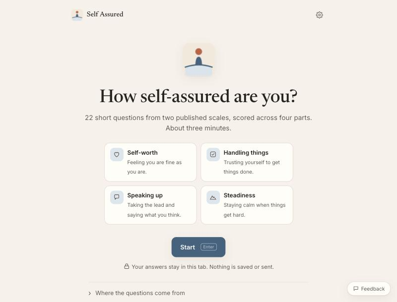
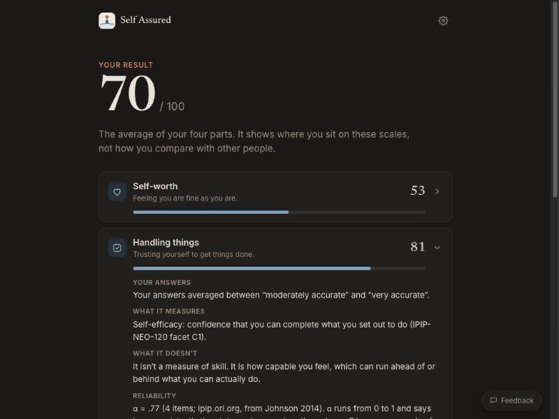

# Self Assured

A 3-minute survey of how self-assured you are, across four parts: self-worth, handling things, speaking up, and steadiness. It uses 22 items from two published, public-domain scales. Your answers never leave your browser.

  
  

| Part | Scale | Items |
|---|---|---|
| Self-worth | Rosenberg Self-Esteem Scale (1965) | 10 |
| Handling things | IPIP-NEO-120 Self-Efficacy (C1) | 4 |
| Speaking up | IPIP-NEO-120 Assertiveness (E3) | 4 |
| Steadiness | IPIP-NEO-120 Vulnerability (N6), reversed | 4 |

Scores run from 0 to 100 and show where you sit on each scale. They are **not** percentiles: there's no comparison with other people.

- **Try it:** https://amalmehta.com/SelfAssured/
- [Setup, running and the manual review checklist](docs/INSTRUCTIONS.md)
- [System design and threat model](docs/SYSTEM-DESIGN.md)
- [What's where](docs/FILE-STRUCTURE.md)
- [Prompt log](docs/PROMPTS.md)

**Sources:** Rosenberg (1965), via [UMD Sociology](https://socy.umd.edu/about-us/using-rosenberg-self-esteem-scale); Johnson (2014), *J. Research in Personality* 51, 78–89, via [ipip.ori.org](https://ipip.ori.org/30FacetNEO-PI-RItems.htm). Fonts: Inter and Newsreader, under the SIL Open Font License.
