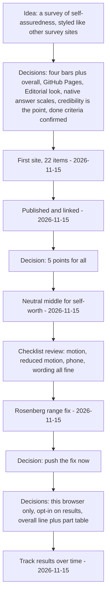
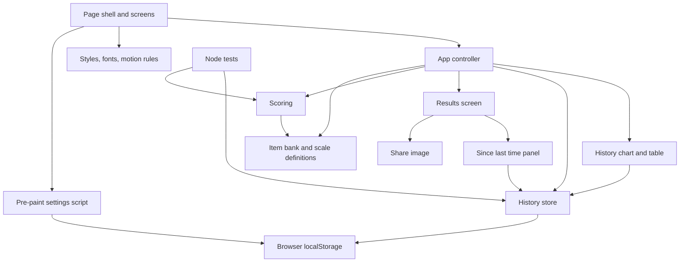
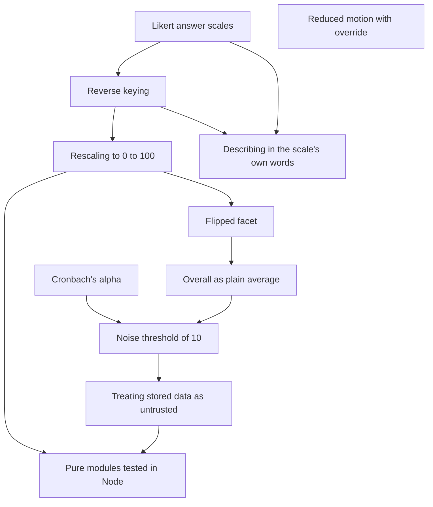

<!-- ProjectForge explainer at 66124da -->
# How SelfAssuredEval was built

Self Assured is a one-page website. It asks 22 questions and shows how self-assured you are in four parts, scored 0 to 100, plus an overall score. It is for anyone curious about their own confidence who wants a real measure, not a personality-type quiz. The core idea is to use only published, public-domain questionnaires word for word. Each item is scored the way the source scored it. That puts every number on the same 0–100 range, so four honest bars can sit side by side and be averaged.

## Build history

- **First site (2026-11-15):** "Self Assured: a 22-item self-assuredness survey site". It combines the 10-item Rosenberg Self-Esteem Scale with three 4-item IPIP facets and shows four bars and an overall score. The author chose this over a shorter quiz with a named type because "credibility is the point".
- **Published (2026-11-15):** The README now links the live site on its real domain, and publishing is recorded in the spec and prompt log. It is hosted on GitHub Pages, as decided.
- **Neutral middle for self-worth (2026-11-15):** At first each scale kept its native answers, so Rosenberg had 4 and IPIP had 5. The author then picked "5 points for all". Rosenberg gained "Neither agree nor disagree", which matches the IPIP items, and it is now scored 0–4.
- **Range fix and checklist review (2026-11-15):** The scoring explanation still said Rosenberg runs "0 and 3". It now says "0 and 4", to match the new 5-point scale. The author also checked motion, Reduce Motion, phone reading, the home-screen icon and the wording of low scores, and all were fine. The fix was pushed straight away rather than held back to ship with tracking.
- **Track results over time (2026-11-15):** This adds saved scores (opt-in from the results screen, kept in this browser only), a "since last time" comparison, a history chart and table, and export and import. A final commit logs the push prompt.

## Code map

| Part | File | What it does |
|---|---|---|
| Page shell and screens | `index.html` | Holds the five screens (`intro`, `quiz`, `switch`, `results`, `history`), the settings `<dialog>` and the inline SVG icon symbols. |
| Pre-paint settings script | `index.html` (lines 15–22) | Reads `sa-settings` from localStorage and sets `data-theme` and `data-motion` before the page first draws, so the page doesn't flash the wrong theme. |
| Styles, fonts, motion rules | `styles.css` | Loads the self-hosted Inter and Newsreader fonts, sets the light and dark colours, and swaps every animation for a fade when reduced motion is on. |
| App controller | `js/app.js` | Runs the screens, question flow, keyboard input, results, history view, share image and settings. |
| Item bank and scale definitions | `js/items.js` | Holds `SCALES` (answer options and ranges), `PARTS` (the four parts and their texts) and `ITEMS` (the 22 statements with their keying). |
| Scoring | `js/scoring.js` | Pure functions (they touch no page elements) that turn raw answers into 0–100 part scores, an overall score and a plain-words description. |
| History store | `js/history.js` | Saves, loads, checks, compares, exports and imports past results. Storage is passed in, so it runs in Node. |
| Browser localStorage | (browser API) | Holds `sa-settings` and, only after the user opts in, `sa-history`. |
| Results screen | `js/app.js` `showResults` | Draws four expandable bars with explanations and the count-up overall number. |
| Since last time panel | `js/app.js` `renderSince` | Shows each part's change against the last saved run, marking small gaps "about the same". |
| History chart and table | `js/app.js` `renderHistory`, `renderTrend` | Draws an SVG line of the overall score and a table of every saved run. |
| Share image | `js/app.js` `saveImage` | Paints a 1080×1350 PNG of the result onto a canvas and downloads it. |
| Node tests | `tests/scoring.test.mjs`, `tests/history.test.mjs` | Check the item set, keying, score bounds, null on missing answers, history cleaning, comparison and round-trip import. They run with `npm test` (`package.json`). |

## Concepts

**Likert answer scales** — A Likert scale asks you to rate a statement on ordered steps, such as "Strongly agree" down to "Strongly disagree", and each step is worth a number. The two sources use different steps. Rosenberg asks about agreement, and here it is scored 4 down to 0. IPIP (the International Personality Item Pool) asks how accurately a phrase describes you, scored 5 down to 1. The project keeps each source's wording and numbers and stores `min` and `max` per scale, so the scoring code never assumes one range. Rosenberg was published with 4 points. A neutral middle was added later, and the code comment cites Donnellan & Rakhshani (2023) as support for using 5. Lives in `js/items.js` (`SCALES`).

**Reverse keying** — Some statements point the opposite way. Agreeing with "I am inclined to feel that I am a failure" means *lower* self-worth. Before averaging, such an answer is mirrored across the scale. The project needs this because 5 of the 10 Rosenberg items and some IPIP items are reversed (`key: -1`). Lives in `js/scoring.js` (`keyed`) and `js/items.js` (`ITEMS`).

$$v' = \begin{cases} v & \text{key} = +1 \\ \text{min} + \text{max} - v & \text{key} = -1 \end{cases}$$

**Rescaling to 0 to 100** — Each part's keyed answers are averaged. The average is then stretched so the lowest possible answer is 0 and the highest is 100. This lets a 0–4 scale and a 1–5 scale share one bar and one average. A score is a position on the scale, not a percentile against other people, and the share image says so. If any answer is missing or out of range, the function returns `null` rather than a wrong number. Lives in `js/scoring.js` (`scorePart`).

$$\text{score} = \frac{\bar{v}' - \text{min}}{\text{max} - \text{min}} \times 100$$

**Flipped facet** — "Steadiness" is the IPIP facet *Vulnerability* (N6) turned around. A high Vulnerability score means panicking easily, so the part score is $100 - \text{score}$ and higher means calmer. The flag is `flip: true` in `PARTS.steady`. It is applied in `scorePart` and also in `describe`, so the words point the same way as the bar. Lives in `js/items.js` and `js/scoring.js`.

**Overall as plain average** — The overall score is the unweighted mean of the four part scores. Self-worth has 10 items and the others have 4, but each part counts the same. This matches the "four bars + overall" decision. Lives in `js/scoring.js` (`scoreAll`). `cleanRun` in `js/history.js` works it out again the same way for stored runs.

**Describing in the scale's own words** — The results never say "low" or "high". `describe` takes the keyed mean answer and finds the nearest answer label below it and above it. It then says, for example, "your answers averaged between 'agree' and 'strongly agree'". This describes what the person said without inventing categories, and it serves the "Reads kindly" check. Lives in `js/scoring.js` (`describe`, `meanKeyed`).

**Cronbach's alpha** — Alpha (α) is a number from 0 to 1. It says how consistently the items in a scale move together, and above .7 is a common rule of thumb for "good enough". The app does not compute α. It quotes the published values (.77–.88 for Rosenberg, .76–.85 for the IPIP facets) and explains them, so the user can judge how much to trust each bar. Lives in `js/items.js` (`reliability` fields) and `js/app.js` (`showResults`).

**Noise threshold of 10** — Each of the three short parts has only four items. That makes small changes between two runs mostly measurement noise. `compare` marks any change under 10 points as "about the same". The page says plainly that 10 is "our rough guide, not a figure from the papers". Lives in `js/history.js` (`NOISE`, `compare`) and `index.html` (the "Estimate" notes).

**Treating stored data as untrusted** — Saved history comes from localStorage, which the user or another script can edit, and from imported JSON files. Both are run through `cleanRun`. It keeps only a valid ISO timestamp and four scores between 0 and 100, rounds them, and recomputes the overall instead of trusting the stored one. Bad entries are dropped, duplicates are skipped on import, and the list is capped at 200 runs. Answers are never stored, only scores. Lives in `js/history.js`.

**Pure modules tested in Node** — The site has no build step. It loads `js/app.js` as a native ES module, which then imports the others. `scoring.js` and `history.js` never touch the page. History functions take `storage` as a parameter, so tests can pass a fake object instead of a real browser. The tests run under Node's built-in test runner. Lives in `package.json`, `tests/scoring.test.mjs` and `tests/history.test.mjs`.

**Reduced motion with override** — Operating systems have a "Reduce motion" setting, which the browser exposes as the `prefers-reduced-motion` media query. Here it turns every animation into a fade and makes transitions instant. A settings choice, stored as `data-motion` on the root element, can force motion on (`full`) or off (`reduce`) whatever the system says. The count-up number in `countUp` checks the same rules. Lives in `styles.css` (lines 236–239), `js/app.js` (`countUp`, `applySettings`) and the pre-paint script in `index.html`.

## One input, start to finish

The input: someone answers "Agree" to all 10 self-worth statements and "Moderately accurate" to all 12 IPIP phrases, using the number keys, and then saves the result.

1. **Page load** — `index.html` runs its inline script, which applies any saved theme and motion setting, then loads `js/app.js`. At boot, `renderIntro` lists the four parts and the source citations, and `refreshHistoryCounts` hides the history button if nothing is saved yet.
2. **Start** — Pressing Enter on the intro calls `onKey` → `start` in `js/app.js`. This resets `state.answers` and calls `renderQuestion(1)` for item `r1`. That draws five buttons with the ARIA role "radio" from `SCALES.rosenberg.options`.
3. **Answer** — Pressing `2` makes `onKey` look up option index 1 ("Agree", value 3) and call `choose(3)`. `choose` stores `state.answers.r1 = 3`, ticks the button and widens the progress bar. After a 180 ms pause (`ADVANCE_MS`), it calls `next`.
4. **Scale switch** — After `r10`, `next` reaches index 10. `SWITCH_AT` is the first IPIP item, so `next` shows the `switch` screen once, which explains the new answer wording. `goOn` resumes the quiz with `c1a`, and key `2` now means "Moderately accurate" (value 4).
5. **Finish** — After `n6d`, `next` calls `showResults`, which calls `scoreAll` in `js/scoring.js`. That calls `scorePart` once for each part:
   - **Self-worth:** five items keyed +1 give 3 each. Five reversed items give $0 + 4 - 3 = 1$ each. The mean is 2, so $\frac{2-0}{4}\times100 = 50$. Agreeing with everything, including "I am a failure", lands in the middle. The test "Agree to everything → 50" checks this.
   - **Handling things:** all four items keyed +1 at 4, so the mean is 4 and $\frac{4-1}{4}\times100 = 75$.
   - **Speaking up:** three items at 4, plus "Wait for others to lead the way" reversed to $1+5-4 = 2$. The mean is 3.5, which gives 62.5.
   - **Steadiness:** "Panic easily", "Become overwhelmed by events" and "Feel that I'm unable to deal with things" at 4, plus "Remain calm under pressure" reversed to 2. The mean is 3.5, which gives 62.5 for Vulnerability, and the flip makes it $100 - 62.5 = 37.5$.
   - **Overall:** $(50 + 75 + 62.5 + 37.5)/4 = 56.25$.
6. **Show** — `showResults` draws four bars that grow on the next animation frame, labelled 50, 75, 63 and 38 after `Math.round`. `countUp` animates the overall from 0 to 56, or just writes it if motion is reduced. Each bar opens to show `describe`'s sentence. For Steadiness, the keyed mean 3.5 is turned round to 2.5. That gives "Turned round so every answer points toward calm, your answers averaged between 'moderately inaccurate' and 'neither accurate nor inaccurate'". Below that come the measure, what it doesn't measure, the reliability note, and every statement with its answer, with reversed ones tagged "flipped".
7. **Compare** — `renderSince` loads history. With no earlier saved run, the panel stays hidden.
8. **Save** — Pressing "Save to my history" calls `onSaveHistory` → `saveRun` in `js/history.js`. `cleanRun` builds `{ at: <ISO time>, parts: { worth: 50, efficacy: 75, assert: 63, steady: 38 }, overall: 56 }`. The overall is rounded from the unrounded parts. `saveRun` appends it to the loaded list, sorts by time, keeps at most 200 runs and writes JSON to localStorage under `sa-history`. The button changes to "Saved · see your history".
9. **Later** — On the next saved run, `renderSince` calls `compare` with this run and the new one. Any part that moved by less than 10 shows "about the same". `openHistory` → `renderHistory` draws the table, and `renderTrend` draws the overall line as SVG with runs evenly spaced. `onExport` downloads the list as JSON wrapped in `{ app: 'Self Assured', version: 1, runs }`, which `importHistory` can merge back.
10. **Share (optional)** — "Save image" calls `saveImage`. It waits for fonts, reads the current theme colours from CSS variables, paints the score and four bars on a canvas, and downloads `Self Assured result.png`.

## Where this came from

Written from the spec, the author's decisions, the git history and the code as of commit `66124da` ("Log the push prompt").
