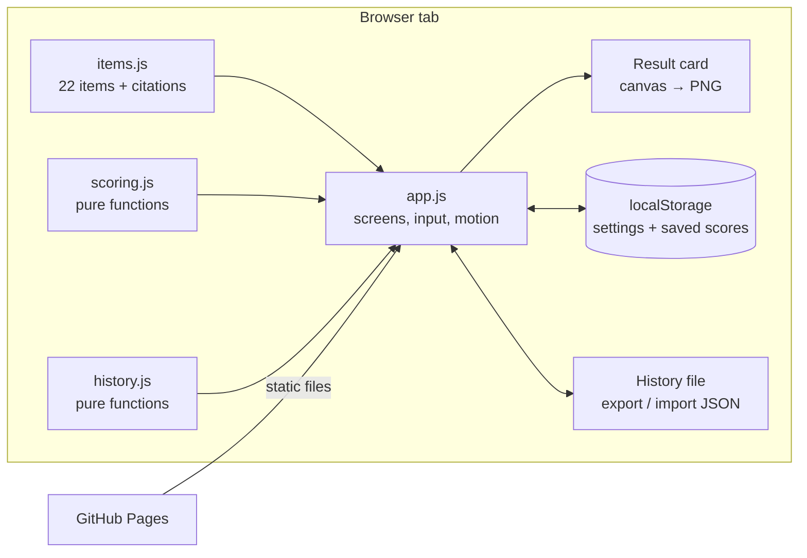

# System Design

Self Assured is a static, single-page survey. It asks 22 validated questions, scores four parts of self-assuredness in the browser, and shows the result. If you choose, it keeps your scores in this browser so you can track them over time. There is no server and no database, and no answer ever leaves the page.

## Architecture

| Piece | Job | Interface |
|---|---|---|
| `items.js` | The 22 items word for word, with keying, the scale each belongs to, answer labels and citations | Exports `SCALES`, `ITEMS`, `PARTS` |
| `scoring.js` | Turns answers into part scores and an overall score. Pure functions with no DOM, so they can be tested in Node | `scoreAll(answers) → {parts, overall}` |
| `history.js` | Saves, loads, compares, exports and imports past scores. Storage is passed in, and every stored or imported entry is validated | `saveRun`, `loadHistory`, `compare`, `importHistory` |
| `app.js` | Intro → questions → results → history, keyboard, settings, feedback, saving the image | DOM only |
| `styles.css` | Light/dark tokens, self-hosted fonts and motion | CSS custom properties |

Each piece can be swapped on its own. For example, a different item set only touches `items.js`, and a stored-results backend would be one new module that `app.js` calls after scoring.

## Main flow

1. **Open:** the mark springs in (≤ 1 s, or a plain fade with Reduce Motion), then the intro eases in. Input is never blocked.
2. **Answer:** pick an option by click, tap, or keys 1–5. It highlights at once (well under 100 ms) and moves on about 180 ms later. ← or Back goes back and keeps the earlier answer.
3. **Result:** `scoreAll` runs, which is a few microseconds of arithmetic. Four bars fill in with eased motion, and each row folds open for detail.
4. **Track (opt-in):** "Save to my history" stores the date and the five scores. Results then show the change since the last saved run, labelling gaps under 10 points "about the same". The history screen draws the overall score by date and lists every run.
5. **Share:** draw the result card onto a canvas and download it as a PNG. Nothing goes in the URL.

## Scoring

Part score, from 0 to 100:

score = (mean item value after reverse-keying − scale min) / (scale max − scale min) × 100

- Rosenberg answers are worth 0–4; IPIP answers are worth 1–5. Both have five answers with a neutral middle.
- Steadiness = 100 − Vulnerability.
- Overall = the average of the four parts. This is our own composite, not a published one.

## Where data lives

- **Answers:** kept in a JavaScript array in memory and gone when the tab closes.
- **Settings:** only `theme` and `motion` are saved, in `localStorage` (`sa-settings`), wrapped in try/catch so the site still works if storage is blocked.
- **History:** only when you press "Save to my history": the timestamp and five rounded scores per run, never answers, in `localStorage` (`sa-history`), capped at 200 runs. Export writes a small JSON file; import merges one back, skipping duplicates and anything malformed. Settings → "Delete history" removes it all.
- **Third parties:** none. Fonts (Inter, Newsreader; SIL Open Font License) are self-hosted in `assets/fonts/`, which also cut first paint on slow connections (Lighthouse showed the Google Fonts stylesheet blocking render).

## Threat model

| Risk | Status |
|---|---|
| Someone reads another person's answers | Nothing is stored or sent, so there is nothing to read. |
| Data leaks through a share link | Sharing exports an image; the URL never carries scores. |
| Someone else on a shared device sees your history | Saving is opt-in per run, and history can be deleted in Settings. Scores only, never answers. |
| A crafted import file | Parsed as JSON, size-capped at 1 MB, every entry validated (date parses, each score a number from 0 to 100), overall recomputed, text set with `textContent`. Bad entries are skipped and counted. |
| Script injection | All text comes from our own static files and is set with `textContent`. No user text is ever rendered. |
| Supply chain | No npm runtime dependencies and no CDN scripts. Nothing is loaded from another origin. |
| A tampered deploy | GitHub Pages is served over HTTPS; the risk is limited to who can push to the repo. |

## Key decisions and trade-offs

- **Validated scales over custom items.** The score means something and can be cited, at the cost of fixed, somewhat stiff wording.
- **Five answers with a neutral middle everywhere.** IPIP is natively 5-point. Rosenberg is published as 4-point; we add "Neither agree nor disagree" so nobody is forced to pick a side. Donnellan & Rakhshani (2023) compared Rosenberg formats and favour 5 points, and studies of 4–7 points found reliability about the same. The cost: the published Rosenberg alphas were measured on 4 points, so the site says so. The answer wording still changes between the two blocks (agree vs accurate).
- **No norms.** We can't honestly say "higher than 70% of people" without a reference sample, so the scores are positions on each scale, not percentiles.
- **No build step.** Plain ES modules are the fewest moving parts. The trade-off is no TypeScript checking.
- **History in the browser, not on a server.** No accounts and nothing to breach, at the cost of history living on one device unless exported. Opt-in, so friends trying it once leave no trace.
- **Change labelled against a noise band.** Gaps under 10 points read "about the same", so people don't over-read wiggles in 4-item scales.
- **MathML instead of KaTeX.** Browsers typeset it natively, so no extra download is needed.

## Testing

- `npm test` covers history (saving only scores, ordering, blocked storage, the noise band, export/import round trips, malformed imports, delete) and scoring: extremes, reverse keys, the steadiness flip, the overall average, and missing-answer guards.
- A browser walkthrough covers the normal path, all-extreme answers, going back, keyboard-only use, 375 px width, and dark mode.
- The manual checklist is in [INSTRUCTIONS.md](INSTRUCTIONS.md#manual-review-checklist).

## Known limits

- The 4-item IPIP facets are short, so their scores are noisy. Published alphas are .76–.85.
- The overall score mixes two instruments with different formats. It is a summary, not a validated measure.
- English only.

## If it grows

| Trigger | What changes |
|---|---|
| Wanting history across devices | Accounts and a small backend, or sync through a file the person keeps. |
| Wanting percentiles | Collect consented, anonymous responses through a tiny backend (for example a serverless function and SQLite or Postgres), or adopt published norms with citations. This brings in consent text and a privacy policy. |
| More than ~1 instrument or translations | Move items into JSON per locale, loaded by `items.js`. |
| Heavy traffic | Nothing changes: static files on a CDN scale on their own. |
